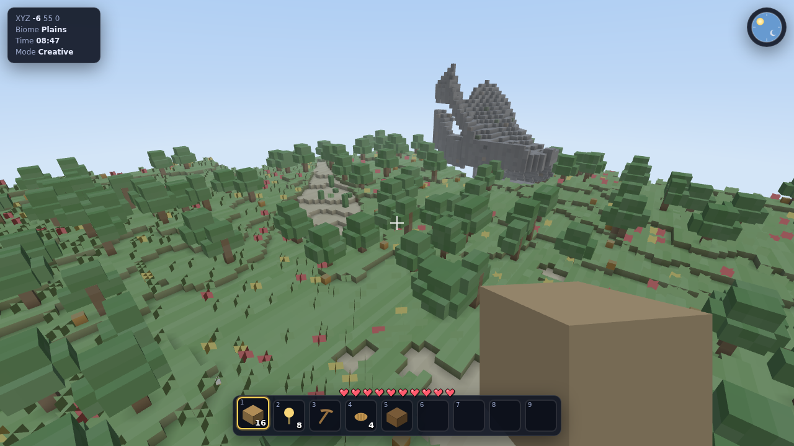
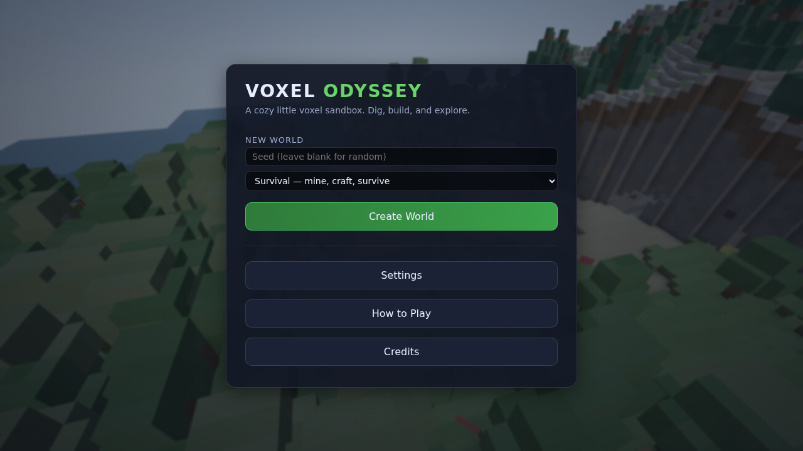
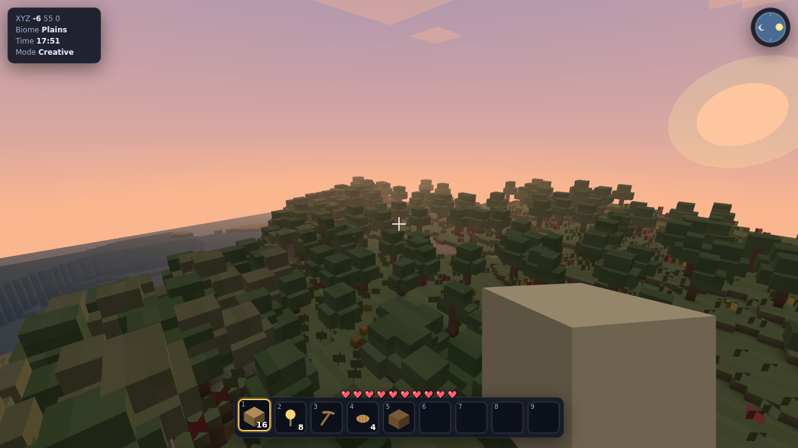
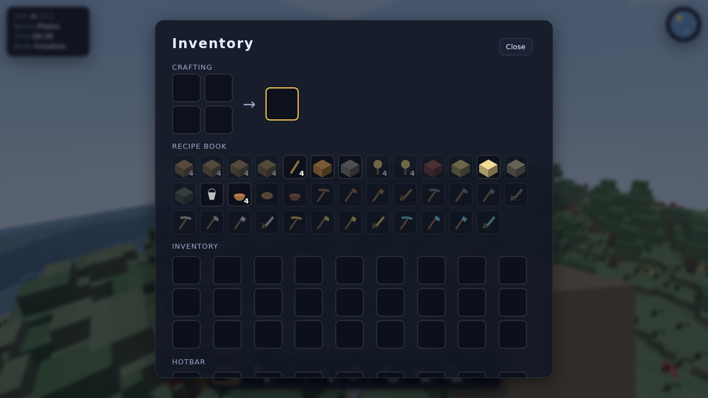

# 🌍 Voxel Odyssey

A fun, fully-featured **first-person voxel sandbox** that runs entirely in your
browser — explore an infinite procedurally-generated world, mine and build,
craft tools, survive the night, and watch the sun rise over your creations.

Built from scratch with **Three.js** (vendored locally — no build step, no
network required) and a hand-rolled voxel engine: procedural terrain & biomes,
face-culled chunk meshing with ambient occlusion, swept-AABB physics,
**Minecraft-style flood-fill lighting**, **multiplayer**, **resource pack
support**, mobs with AI, crafting, particles, and fully synthesized audio
(no asset files anywhere).



<p align="center">
  
  
  
</p>

## ▶️ Play

### The quick way — one file, no server

Download **[`dist/voxel-odyssey.html`](dist/voxel-odyssey.html)** and double-click
it. That's the whole game — engine, Three.js, art and audio — in a single 1.5 MB
file with everything inlined, so it opens straight from disk and works offline.

### From source

The source runs unbundled via ES modules + an import map, which browsers only
allow over HTTP. From this folder:

```bash
# pick any one:
python3 -m http.server 8080
npx serve -l 8080 .
npx http-server -p 8080 .
```

Then open <http://localhost:8080> and click **New World**.

> Click the screen to capture the mouse. Press **Esc** to pause / release it.
> Where a page embeds the game and blocks the Pointer Lock API, it falls back
> automatically to hiding the cursor and steering on raw mouse movement.

### Rebuilding the single file

```bash
npm install          # esbuild, the only dev dependency
npm run build        # -> dist/voxel-odyssey.html
npm run build:fragment   # same, minus the <html>/<head>/<body> wrapper, for embedding
```

## 👥 Multiplayer

Run a server — it hosts the game *and* serves the client, so one process is
the whole setup:

```bash
npm run server                 # http://localhost:8090
node server/index.js --port 8090 --seed my-world --max-players 32
```

Open that address in a browser and press **Join Multiplayer** (it defaults to
the server you loaded the page from). Others join the same address.

The server is authoritative over the world: block edits are validated for
reach and rate, then broadcast, so two players racing for the same block
always resolve the same way for everyone. Clients apply their own edits
immediately and reconcile against the server's answer, so building stays
responsive at any latency. Remote players are interpolated and fully
animated. `GET /status` reports player count, tick and edit count.

No dependencies — the WebSocket layer is implemented directly against
RFC 6455.

## 🎨 Resource packs

**Drag a Minecraft resource pack `.zip` onto the window.** Packs from
Modrinth, CurseForge or anywhere else work as-is — no unpacking, no
conversion. Textures the pack doesn't include keep the built-in procedural
versions, and both modern (`grass_block_top`) and pre-1.13 (`grass_top`)
naming is understood. The pack is remembered between sessions.

Without a pack the game synthesizes its own complete 16px texture set at
startup, generated as code rather than shipped as art.

### Finding and checking packs

```bash
node tools/fetch-pack.mjs --search faithful      # search Modrinth
node tools/fetch-pack.mjs <modrinth-slug>        # download into packs/
node tools/fetch-pack.mjs --check some-pack.zip  # coverage report only
```

`--check` reports how many of the game's texture slots a pack actually fills,
which is the quickest way to tell a complete pack from a partial one. It is
worth running first: many popular "texture packs" turn out to be PBR
supplements whose files are all `_n`/`_s` normal and specular maps with no
base colour textures, so they change nothing in game. The tool calls that out
explicitly.

`packs/` is gitignored. Complete Minecraft texture packs are substantial
original artwork and are nearly always All Rights Reserved — fine to download
and play with privately, not something this repository should redistribute.

## 🎮 Controls

| Action | Key |
| --- | --- |
| Move | `W` `A` `S` `D` |
| Look | Mouse |
| Jump | `Space` |
| Sprint | `Ctrl` (hold) or double-tap `W` |
| Sneak | `Shift` |
| Mine block | Hold **Left Mouse** |
| Place block / use / eat | **Right Mouse** |
| Attack mob | **Left Mouse** (click) |
| Select hotbar slot | `1`–`9` or mouse wheel |
| Open inventory / crafting | `E` |
| Drop item | `Q` |
| Toggle creative flight | `F` (in creative) |
| Debug overlay | `F3` |
| Pause / menu | `Esc` |
| Free the mouse without pausing | `U` (click the game to capture it again) |
| Open a furnace / chest / crafting table | **Right Mouse** on it |
| Move a stack between chest and inventory | `Shift` + click |

Every binding is remappable in **Settings → Customise Controls**. Gamepads are
supported (left stick moves, right stick looks) with an adjustable deadzone
and look speed.

**Phones and tablets** get on-screen controls automatically: a movement stick on
the left, **Mine** (hold) / **Place** / **Jump** (plus **Sneak** and, in creative,
**Fly**) on the right, **Bag** and **II** (pause) at the top, drag anywhere else
to look, and tap the hotbar to choose an item. They hide behind menus. Add
`?touch=1` to the URL to force them on, `?touch=0` to force them off.

## ✨ Features

- **Infinite procedural world** — climate-driven terrain (continentalness,
  erosion, temperature, humidity) with broad continents, plains, forests,
  deserts, savannas, taigas, mountains, beaches and oceans; caves, ravines,
  lava pools, ore veins, trees, flowers, cacti and mushrooms. You spawn on a
  real stretch of land, not a sandbar.
- **Biome colour** — grass, leaves and water are tinted by the local climate
  from a smooth colour table, so a savanna reads gold and a taiga cool and dark
  with no visible seams between biomes.
- **Mine & build** — 40+ block types, face-culled chunk meshing with ambient
  occlusion and per-voxel color variation for a clean low-poly look.
- **Crafting & inventory** — a full 36-slot inventory, 2×2 and 3×3 crafting,
  drag-and-drop, a recipe book, tools of five tiers, food, and torches.
- **Smelting** — right-click a furnace, put ore (or raw meat, sand, clay, logs)
  in the top slot and coal, charcoal, logs or planks in the fuel slot. Iron and
  gold ingots, glass, stone, bricks, charcoal and cooked meat all come from
  here, and the furnace glows while it burns. Contents are saved with the world.
- **Chests** — craft one from eight planks, right-click it to open 27 slots of
  storage; shift-click moves stacks between chest and inventory, and worn tools
  keep their wear. Contents are saved with the world and spill when it breaks.
- **Saplings** — leaves occasionally drop saplings; plant one on grass or dirt
  and it grows into an oak, birch or pine given light and room (single-player).
- **Tool wear** — tools lose durability as you mine and fight, show a bar under
  their icon, and break when used up. Wear survives moving, saving and loading.
- **Survival** — health, fall damage, drowning, hunger for food, and a
  **Creative** mode with flight for pure building.
- **Mobs** — passive animals (pig, cow, sheep, chicken) and hostiles that come
  out at night (zombie, skeleton, spider) with simple chase/melee AI.
- **Lighting** — baked voxel light plus a real sun: hemisphere ambient, direct
  sun (faces turned toward it are brighter) and moonlight, all combined in
  linear colour and tone-mapped, with animated, reflective water.
- **Dynamic day/night** — a moving sun and moon, gradient sky, blocky voxel
  clouds fixed in the world (so they have parallax), a starfield, and fog that
  ends where the world does, all shifting through dawn, day, dusk and night.
- **Effects & audio** — block-break particles, water splashes, and a fully
  **synthesized** soundscape + gentle ambient music (zero audio files).
- **Saves** — your world (seed + your edits + inventory) persists in
  `localStorage`; **Continue** picks up where you left off.

## 🧱 Architecture

Everything is plain ES modules under `js/` (no bundler). See
[`ARCHITECTURE.md`](ARCHITECTURE.md) for the full module contract.

```
index.html            import map + loading screen + UI layers
styles.css            HUD / menu / inventory styling
vendor/three.module.js  Three.js r160 (vendored, MIT)
js/
  main.js             bootstrap, game-flow state machine, the loop
  core/   utils, events (bus), state (settings/save), input, engine
  world/  constants, blocks, noise, climate, worldgen, trees, growth, biomeColor,
          chunk (mesher), world, lighting (flood fill), meshPool + mesher.worker
  render/ material (voxel shader), atlas (texture array), textures
          (procedural set), resourcepack (.zip reader), resources
  net/    client (prediction + interpolation), remotePlayers (rigs)
  entities/  player, mob, entityManager
  items/  items (registry + icons), inventory, crafting, furnace (smelting), chest
  fx/     particles, audio, sky, weather
  ui/     hud, menus, touch (on-screen controls)
shared/ protocol.js  — wire format, imported by both client and server
server/ index.js (game server + static host), websocket.js (RFC 6455)
tests/  node: run, lighting, resourcepack, pathfinder, worldgen, furnace, biomecolor,
        growth, chest, multiplayer · browser: smoke, interact, e2e-controls,
        e2e-furnace, e2e-sapling, e2e-chest, e2e-touch
tools/  build-single-file.mjs (inlines everything into dist/voxel-odyssey.html)
```

### How lighting works

Terrain is **not** lit by a directional light — one can't be occluded by
voxels, so caves and sealed rooms came out as bright as open ground. Instead
`world/lighting.js` floods light through the voxel grid the way Minecraft
does: skylight seeded at 15 per column, falling straight down unattenuated and
spreading sideways at 1 per step, plus blocklight from torches and glowstone.
Both are packed as nibbles into one byte per voxel.

The mesher emits that light as a **vertex attribute** while the time of day
stays a **uniform**, so a full day-to-night swing re-lights every chunk in the
world without re-meshing any of it.

The fragment shader (`render/material.js`) then lights in **linear** colour:
albedo is converted out of sRGB, lit by hemisphere ambient (up-facing surfaces
see the sky, down-facing ones the ground) plus a directional sun/moon term that
only reaches cells that can see most of the sky, plus warm torchlight, and the
result is tone-mapped and re-encoded. The sky supplies the ambient/sun colours
as linear uniforms (`Sky.getTerrainLight()`), and drives the three.js lights
that mobs use from the same numbers, so a pig is lit like the grass it stands
on. Doing this in display space instead — multiplying light levels into sRGB
colours — compounds the darkening and renders mid-green leaves near black.

## 🧪 Tests

```bash
npm test                     # all Node suites (~360 assertions)
node tests/run.js            # pure logic: noise, worldgen, meshing, inventory, crafting
node tests/lighting.test.mjs # light propagation: falloff, shadows, relighting, cross-chunk
node tests/resourcepack.test.mjs  # the ZIP reader, against archives built byte-by-byte
node tests/worldgen.test.mjs      # determinism, seams, surface mix, landmass size, spawn quality
node tests/furnace.test.mjs       # smelting rules, fuel, persistence, tool wear
node tests/biomecolor.test.mjs    # tint model, mesher integration, climate recording
node tests/growth.test.mjs        # tree shapes + sapling growth against a mock world
node tests/chest.test.mjs         # storage rules, stack moving, persistence
node tests/multiplayer.test.mjs   # protocol round-trips + a live server driven by real sockets

npm run test:browser         # headless Chromium: rendering + real gameplay
                             # (e2e-controls: real mouse; e2e-furnace / e2e-chest / e2e-sapling: real clicks;
                             #  e2e-touch: emulated phone with touch events)
```

## 📄 License

MIT. Three.js © its authors (MIT), vendored in `vendor/`.
